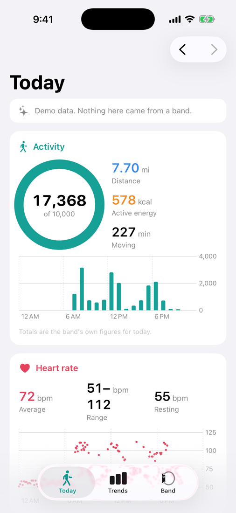
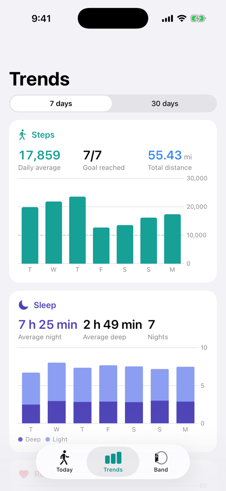
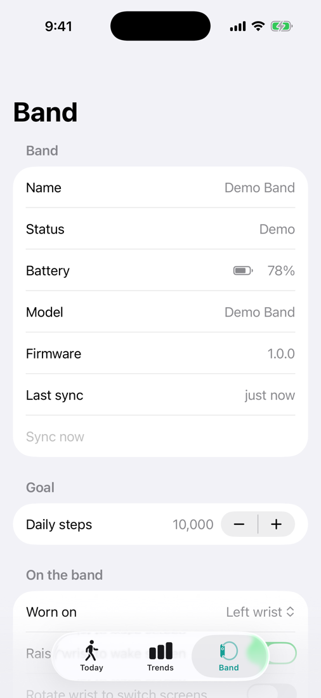
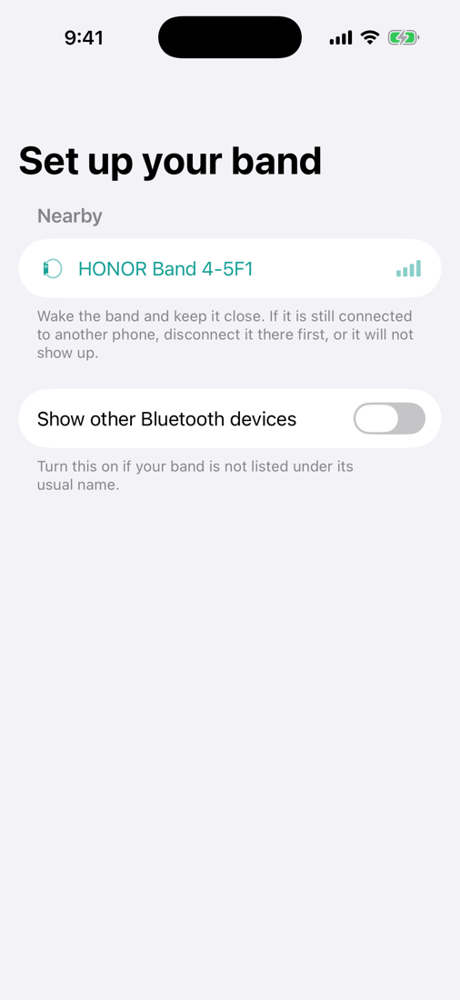

# Band Companion

An iPhone app for the **Honor Band 4**, for people whose band is no longer supported by the
official app. It pairs with the band over Bluetooth, sets its clock and options, and reads
steps, distance, active energy, heart rate and sleep from it.

This is an independent project. It is not made by, endorsed by or affiliated with Honor or
Huawei, and it is not a medical device.

> **Status: untested on real hardware.** Everything here was written and tested without a
> band. The protocol code is checked against known-good byte sequences and against a
> simulated band, and the app is compiled and launched in the iOS simulator on every change,
> but nobody has yet paired it with an actual Honor Band 4. Expect the first real connection
> to need a round or two of fixes. The app has a diagnostics log made for exactly that; see
> [If something does not work](#if-something-does-not-work).

## What it looks like

These are from the iOS simulator running the app's demo mode, so the numbers are made up.

<p>
  
  
  
  
</p>

## What it does

| | |
|---|---|
| Pairing | Finds the band, runs its handshake, stores the link key in the iOS keychain |
| Sync | Per-minute steps, distance, active energy and heart rate; light and deep sleep; battery level |
| Band setup | Clock and time zone, 12/24-hour and date format, language and units, wrist, raise-to-wake, continuous heart rate, step goal, height/weight/age for the band's estimates |
| Screens | A daily dashboard, 7- and 30-day trends, band settings, diagnostics |

Synced data stays on the phone, in the app's own storage. Nothing is sent anywhere.

## What it does not do

- **Call and message notifications on the band.** iOS does not let one app read another app's
  notifications, so the app cannot forward them. Whether the band will still pick them up
  directly from iOS, as it does with the official app, is unknown until tried.
- Alarms, workout records, weather, music control, find-my-phone and firmware updates.
- Writing to Apple Health.
- REM sleep and sleep scores. The app asks the band to do its own sleep analysis, which
  yields light and deep sleep. The official app's finer breakdown is computed by that app,
  not the band.

## Installing it

iOS only runs apps that are signed for your device, so there is no file to simply download
and open. There are two ways to get it onto a phone.

**With a Mac.** Open `BandCompanion.xcodeproj` in Xcode (an iPhone 17 Pro needs Xcode 26 or
later). Select the BandCompanion target, and under *Signing & Capabilities* choose your team
and change the bundle identifier to something of your own. Connect the phone, pick it as the
run destination and press Run. The first time, the phone will ask you to turn on Developer
Mode and to trust your developer certificate in Settings.

**Without a Mac.** Every change to this repository builds an unsigned app. Open the latest
successful *iOS app* run under the repository's **Actions** tab and download the
`BandCompanion-unsigned-ipa` artifact. Then sign and install it with a sideloading tool that
uses your own Apple ID, such as AltStore or Sideloadly, from a Windows or Mac computer.

With a free Apple ID, Apple makes any app installed either way stop opening after seven
days until it is signed and installed again. Your data survives that. A paid developer
account stretches it to a year.

## Pairing

1. Make sure the band is not connected to another phone. If the old phone is nearby, turn
   its Bluetooth off or remove the band in the app there.
2. Open Band Companion and pick the band from the list. It is named `HONOR Band 4-` followed
   by three characters.
3. If the band shows a pairing prompt, accept it.
4. The app may ask for the band's **Bluetooth address**. iOS hides this from apps, and the
   band needs it once, to pair. The app first tries to get it from the band itself and only
   asks if that fails. On the band it is under More, in System or About, on a line labelled
   MAC. The last three characters match the ones in the band's name.

After that the app reconnects and syncs on its own whenever it is opened with the band in
range.

## The first sync: what to check

Because this has not run against a real band, compare these once:

- **Steps, distance and energy** on the Today screen against the band's own screen. The
  Diagnostics screen (Band → Diagnostics) shows the band's totals next to the sum of its
  per-minute records; the two should be close.
- **Times.** Check that a walk shows up at the hour it happened and that last night's sleep
  starts and ends when it should. A shift of whole hours would point to a time zone problem.
- **Sleep** needs a night of wear after pairing before anything appears.

## If something does not work

Open Band → Diagnostics, tap the share button and send the log along with a description of
what happened. The log is a transcript of the conversation with the band. It contains the
band's serial number and your activity figures. It never contains the pairing key, and the
one message that could reveal it is left out.

Common situations:

- *The band is not in the list.* It is probably still connected to another phone, which
  stops it advertising. Also try the "Show other Bluetooth devices" switch.
- *"Pairing did not take."* The address was wrong. Check it against the band's screen.
- *"The band no longer accepts this phone's pairing."* The band was reset or paired
  elsewhere. Use Pair again; your synced data is kept.

## How it is put together

```
Sources/BandKit    The protocol library. No Apple frameworks, so it also builds on Linux.
  Crypto/            SHA-256, HMAC and AES-128-CBC
  Wire/              Framing, the tag-length-value format, handshake maths
  Session/           Request/reply handling, pairing, commands, the sync engine
  Model/             Data types and daily summaries
  Store/             On-disk storage, one small file per day
Tests/BandKitTests  Unit tests, including a simulated band
App/                The SwiftUI app: Bluetooth transport, state, screens
```

Run the library tests with `swift test`. To look at the screens without a band, run the app
in the simulator with the launch argument `-demo`; it fills a throwaway store with made-up
data.

### How the band talks

The band exposes one Bluetooth LE service (`FE86`) with a characteristic to write to
(`FE01`) and one that notifies (`FE02`). Messages are framed with a magic byte, a length and
a CRC-16, and carry a service number, a command number and a list of tag-length-value
fields. Pairing has three steps: both sides prove knowledge of a fixed secret with HMAC
digests over a pair of nonces; the phone sends a link key of its own making, encrypted under
a key derived from fixed constants and the band's Bluetooth address; from then on every
command body is AES-CBC encrypted under that link key.

## Credits and licence

The protocol was worked out by other people. This project's understanding of it comes from
two open-source projects, and the code here was written against the behaviour they
document:

- [Gadgetbridge](https://codeberg.org/Freeyourgadget/Gadgetbridge) (AGPL-3.0), whose Huawei
  and Honor support is the most complete description of this protocol there is.
- [huawei-lpv2](https://github.com/zyv/huawei-lpv2) by Yury V. Zaytsev (MIT), a Python
  client written for the Honor Band 4.

Band Companion is licensed under the GNU Affero General Public License, version 3 or later.
See [LICENSE](LICENSE).
